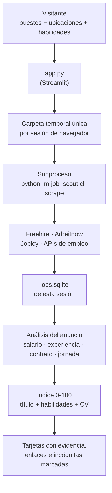

# JobScout Pro

JobScout Pro es una aplicación Streamlit para recoger, visualizar, filtrar y priorizar ofertas guardadas en SQLite. El ranking es un índice orientativo, no una probabilidad de conseguir el empleo.

El motor de recogida incluido en `src/job_scout` se basa en [job-scout](https://github.com/weberwcwei/job-scout), distribuido bajo licencia MIT. Consulta `THIRD_PARTY_NOTICES.md`.

## Cómo funciona, en una imagen



Tres decisiones que explican casi todo lo demás:

1. **Cada sesión tiene su propia carpeta y su propia base de datos.** Nada se comparte entre visitantes: si tu sesión no ha buscado nada, la app te lo dice en vez de enseñarte resultados ajenos.
2. **La búsqueda corre en un subproceso** con un entorno saneado. Si un portal bloquea o tarda, la interfaz no se cuelga y tus credenciales no viajan al proceso hijo.
3. **El índice de encaje es determinista.** Se calcula con reglas que puedes leer: coincidencia de título, tus habilidades y el solapamiento con tu CV. Sin modelos de lenguaje, sin claves de API y sin coste por búsqueda.

## Estado y límites importantes

- El dashboard solo muestra ofertas que realmente están guardadas en SQLite. No crea vacantes ficticias cuando la base está vacía.
- El sistema descarta URLs que parecen páginas de búsqueda o portales genéricos. Esto no demuestra que la vacante siga activa ni que la página no haya cambiado; para eso hay que volver a consultar el portal de origen.
- El dashboard y el motor de recogida `job_scout.cli` están incluidos en este repositorio, dentro de `src/job_scout`.
- Los sitios de empleo pueden cambiar enlaces, retirar vacantes o aplicar límites. Respeta sus términos de uso.

## Modo multiusuario de la aplicación web

La aplicación web pública arranca con puestos y ubicaciones vacíos: cada visitante introduce su propia búsqueda. Cada sesión del navegador recibe un identificador aleatorio, una configuración temporal y una base SQLite propia; la lectura de ofertas nunca recurre a una base compartida si la base de esa sesión no existe o está vacía. Los datos de un perfil anterior no se usan como valores por defecto.

El selector del CV permanece desactivado hasta que el usuario marque una casilla de consentimiento situada antes de la subida. La extracción del PDF se hace en memoria con límites de 5 MB, 15 páginas y 100.000 caracteres extraídos. El texto del CV no se escribe en la configuración del rastreador ni en SQLite. El ranking ordinario es local y determinista; una revisión externa con IA está disponible solo como opción separada, requiere otro consentimiento explícito y una clave API personal de Groq.

La casilla de consentimiento puede desmarcarse en cualquier momento; al retirarla se borra el texto extraído del estado de la sesión y se reinicia el selector del archivo. El botón «Borrar CV y archivo» permite hacerlo explícitamente.

Las búsquedas y los resultados se guardan en un espacio temporal independiente por sesión. La app intenta eliminar espacios inactivos de más de 24 horas cuando procesa nuevas peticiones; esto no constituye una garantía de borrado físico inmediato de la infraestructura del proveedor de alojamiento.

El espacio está pensado para una beta web compartida y no sustituye a un sistema de autenticación o gestión de cuentas. Consulta [PRIVACY_REVIEW.md](PRIVACY_REVIEW.md) para los flujos de datos y la lista de comprobaciones previas a un lanzamiento comercial.

## Filtros opcionales y lectura de requisitos

Los filtros avanzados están desactivados por defecto. El usuario puede activar, de forma independiente, un salario mínimo bruto anual en EUR, nivel de experiencia, tipo de contrato y modalidad de trabajo. Por defecto, los anuncios sin información suficiente se mantienen; cada filtro permite excluir los datos desconocidos de forma expresa.

Las tarjetas incluyen una lectura automática y explicable de las condiciones: salario publicado y periodo, años de experiencia detectados, nivel aproximado, tipo de contrato, modalidad y herramientas mencionadas. Si se carga un CV con consentimiento, se comparan los requisitos detectados con el texto disponible en la sesión. Esta extracción no es un LLM ni una predicción de contratación; muestra evidencia encontrada, no inventa datos que falten y puede pasar por alto formulaciones poco habituales. Los importes en monedas distintas del EUR no se convierten para el filtro salarial.

## Ranking de ofertas y revisión opcional del CV con IA

JobScout Pro no envía tu CV a ningún modelo durante la búsqueda o el cálculo normal del ranking. El índice de encaje se calcula con un algoritmo determinista y auditable:

- solapamiento de vocabulario entre tu CV y el texto del anuncio;
- coincidencia de títulos, incluidos alias profesionales («Hydrogeologist» ↔ «Groundwater Specialist»);
- las habilidades que escribas en **Personalizar el ranking**, que viven solo en la memoria de tu sesión: no se escriben en disco, no llegan al rastreador y desaparecen al cerrar la pestaña;
- una penalización conservadora cuando el anuncio pertenece a otro dominio profesional.

Las mismas entradas producen siempre la misma puntuación. La revisión de CV con IA es una herramienta aparte, situada en la pestaña **Calidad del CV**; no modifica las ofertas ni el ranking de forma automática.

### Cómo activar la revisión con IA

1. Carga un CV y acepta su procesamiento local en la barra lateral.
2. Abre **Calidad del CV**, lee la información de privacidad y marca el consentimiento específico para Groq.
3. Crea una clave personal en [Groq Console](https://console.groq.com/keys), introdúcela en el campo protegido y pulsa **Analizar CV con IA**.
4. El informe revisa claridad, estructura, evidencias de impacto, competencias que aparecen en el documento, compatibilidad ATS y familias de puestos posibles. No evalúa características protegidas, no inventa experiencia ni representa una probabilidad de contratación.

La app solo transmite el texto extraído (no el PDF), elimina automáticamente correos, teléfonos y enlaces comunes y limita el fragmento enviado a 18.000 caracteres. El resto del texto puede seguir conteniendo información personal: revisa el documento antes de dar consentimiento. La clave API y el informe permanecen en la memoria de la sesión; no se escriben en YAML, SQLite ni en el repositorio. En una instalación alojada por terceros, la clave también pasa por el servidor de JobScout para realizar la petición: no la introduzcas en un despliegue cuyo administrador no sea de confianza. Para mayor control, utiliza tu propia instalación local o un servidor que administres. Retirar el consentimiento de IA borra el informe y la clave del estado de sesión; borrar o sustituir el CV también invalida el informe.

La integración utiliza `openai/gpt-oss-20b` en el plan gratuito de Groq, sujeto a disponibilidad y límites de uso. No se intenta pasar automáticamente a un plan de pago. Groq indica que no usa los datos de clientes para entrenar modelos propios y que las peticiones de inferencia no se conservan por defecto; puede registrar entradas y salidas temporalmente (hasta 30 días) por motivos de fiabilidad o abuso. La documentación indica que los datos retenidos se almacenan en GCP en Estados Unidos. Groq ofrece controles Zero Data Retention (ZDR), que el usuario puede activar en su cuenta. Consulta [tratamiento de datos de Groq](https://console.groq.com/docs/your-data), [límites](https://console.groq.com/docs/rate-limits) y [modelo seleccionado](https://console.groq.com/docs/model/openai/gpt-oss-20b).

Sin clave o sin consentimiento, el dashboard sigue funcionando con su ranking local y análisis determinista; la revisión de IA nunca se activa por sí sola.

## Modos de búsqueda

- **Rápida** (predeterminada en el dashboard): consulta una selección de fuentes y términos, limita la paginación, reduce los reintentos y no descarga cada descripción de LinkedIn por separado. Está pensada para obtener una primera lista con menos peticiones.
- **Completa**: intenta cubrir más resultados y recuperar más información. Puede tardar más y está sujeta a bloqueos, límites y cambios de las páginas externas.

No se garantiza una duración fija: el tiempo depende de la respuesta de cada portal. El panel muestra el registro de la ejecución y conserva los resultados que el motor haya guardado.

## Fuentes de búsqueda y diagnóstico

La búsqueda rápida prioriza **Freehire**, **Arbeitnow** y **Jobicy**, fuentes con respuestas estructuradas. Jobicy aporta vacantes remotas elegibles por país o región; su feed se consulta por región y se filtra por puesto localmente, sin enviar el texto del CV ni las búsquedas de empleo. La caché pública se conserva una hora para evitar consultas repetidas. La búsqueda completa amplía la cobertura con más términos y páginas. LinkedIn e Indeed permanecen como adaptadores opcionales, desactivados por defecto. Google Jobs se omite porque el resultado actual requiere JavaScript y el parser del servidor no puede recogerlo de forma fiable.

- **Freehire** permite lecturas sin clave para uso personal y no comercial. Para mostrar sus ofertas en una aplicación o producto que ofrezcas a otras personas (también si es gratuito) hace falta un plan API; el plan API publicado cuesta actualmente 29 USD/mes. La versión compartida no debe habilitar esa fuente sin la licencia correspondiente. Consulta [API y licencia](https://freehire.me/jobs-api) y [documentación](https://freehire.me/docs/api).
- **Arbeitnow** ofrece un feed europeo; sus términos exigen enlazar de vuelta a Arbeitnow y permiten revocar el permiso API. Las tarjetas de JobScout incluyen ese enlace de atribución. Consulta las [condiciones API](https://www.arbeitnow.com/terms).
- **Jobicy** ofrece un feed público de empleo remoto, sin clave API, con filtro por elegibilidad geográfica y una ventana de anuncios recientes de siete días. JobScout mantiene el enlace canónico de Jobicy y muestra su atribución; la API recomienda no consultar el feed más de una vez por hora. Consulta la [documentación y condiciones de uso](https://jobicy.com/jobs-rss-feed).
- La aplicación registra por fuente las consultas, anuncios recibidos, consultas vacías y errores. Si ninguna fuente devuelve ofertas utilizables, la búsqueda termina con advertencia y código de error: ya no se presenta un resultado vacío como si todo hubiera salido bien.
- Los portales pueden limitar peticiones, cambiar sus páginas o retirar anuncios. La comprobación de URL confirma que el enlace es específico, pero no garantiza que el puesto siga abierto; comprueba la oferta antes de solicitarla.

## Uso responsable y límites legales

JobScout Pro es una herramienta **personal y educativa**, no un servicio comercial ni un producto ofrecido a terceros. Conviene tenerlo presente al compartirla:

- **Freehire** se limita a uso personal/no comercial sin clave. Para mostrar sus ofertas en un producto ofrecido a terceros hace falta un plan API; no habilites esa fuente en una instancia compartida sin contratar la licencia.
- **LinkedIn** e **Indeed** restringen el scraping automatizado en sus condiciones. Se mantienen como adaptadores opcionales para instalaciones personales bajo responsabilidad de quien las active; no los habilites en un servicio compartido sin autorización expresa o acceso contractual.
- Respeta los límites de peticiones de cada portal y no uses la herramienta para recopilar datos a gran escala.
- El índice de encaje es orientativo: no es una probabilidad de contratación ni un filtro automático de candidaturas.

## Iniciar en Windows

Requiere Python 3.10 o superior. Para la mayoría de usuarios basta con hacer doble clic en **`INICIAR-JOBSCOUT.bat`**. El lanzador crea un entorno virtual `.venv` dentro de esta carpeta, instala las dependencias y abre JobScout en `http://127.0.0.1:8502`. El servidor escucha solo en el propio equipo; no expone el dashboard a la red local ni a Internet. Mantén abierta la ventana negra mientras uses la aplicación y ciérrala para detenerla.

También puedes iniciarlo manualmente desde PowerShell:

```powershell
python -m venv .venv
.\.venv\Scripts\python.exe -m pip install -r requirements.txt
$env:PYTHONPATH = "src"
.\.venv\Scripts\python.exe -m streamlit run app.py --server.address 127.0.0.1 --server.port 8502 --server.headless false --browser.gatherUsageStats false
```

El dashboard usa `busqueda.example.yaml` como plantilla neutral y crea una base de datos temporal aislada para cada sesión. No necesitas copiar ni editar un YAML para buscar: escribe los puestos y ubicaciones en la barra lateral, añade habilidades si te ayudan a ordenar y carga el CV solo después de dar consentimiento. Cada familiar puede abrir su propia sesión y hacer una búsqueda distinta; el CV no se guarda en el YAML ni en SQLite.

Para el uso normal, inicia siempre con `INICIAR-JOBSCOUT.bat` o con el comando manual de arriba. No uses `streamlit run app.py` sin `--server.address 127.0.0.1` en una máquina que tenga datos personales, porque el servidor podría escuchar en otras interfaces de red.

## Base de datos

La aplicación busca la base de datos en una lista corta de ubicaciones conocidas. Puedes definir la ubicación exacta mediante una variable de entorno:

```powershell
$env:JOBSCOUT_DB_PATH = "C:\Users\TU_USUARIO\AppData\Local\job_scout\jobs.db"
```

También se puede configurar `db_path` en el YAML privado. La app abre la base en modo de solo lectura y busca una tabla con registros que incluyan título y empresa. Si no encuentra ofertas válidas, muestra un aviso en vez de inventar resultados.

## Filtros y ofertas con información incompleta

Los filtros son acumulables: puesto/palabra clave, fecha de publicación, relevancia, fuentes, salario mínimo/máximo, experiencia, tipo de contrato, modalidad, duración y horas semanales. Experiencia, contrato, modalidad y duración permiten seleccionar varias opciones.

**Regla de datos desconocidos:** los campos ausentes o no comparables se mantienen en los resultados por defecto. Cada filtro tiene una opción para conservar o excluir expresamente las ofertas sin ese dato. La extracción de duración, horas y salario se basa en texto/metadatos explícitos; no se consideran valores estimados como si fueran datos publicados.

El modo sin CV sigue disponible: basta con indicar uno o varios puestos y una ubicación. El CV es opcional y se utiliza para el análisis de relevancia local; el envío a la IA externa es una acción independiente con su propio consentimiento.

## Compartir el Top 10 sin configurar servicios

En la pestaña **Alertas**, JobScout muestra el Top 10 y un botón **Compartir Top 10**. En los navegadores que admiten el menú nativo de compartir, puedes elegir una aplicación que ya uses, como correo o mensajería. No necesitas crear una cuenta, configurar un bot ni introducir contraseñas en JobScout. Tú confirmas el envío desde la aplicación elegida.

Si el navegador no admite ese menú, el botón intentará **copiar el resumen automáticamente** para que solo tengas que pegarlo en tu correo o mensajería. Si el navegador también bloquea el portapapeles, pulsa **Descargar resumen completo (.txt)**. Incluye puestos, empresas, puntuación orientativa, condiciones conocidas, pros, puntos que conviene comprobar y enlaces a los anuncios originales.

La app no envía mensajes por su cuenta ni programa avisos en segundo plano: compartir es una acción manual y explícita. Un envío automático de correo necesitaría credenciales de envío o un servicio externo; para conservar una experiencia sencilla no se pide configurar nada de eso.

**Importante:** los campos que el anuncio no publica aparecen como «No indicado» y la oferta se conserva por defecto. Solo se excluye un campo desconocido si el usuario activa expresamente el ajuste correspondiente.

## Pruebas

```powershell
pip install pytest
python -m pytest -q
python scripts/simulate_ranking.py
```

Las pruebas cubren rechazo de URLs genéricas, separación de enlace del anuncio y de candidatura, coincidencias por palabras completas, carga y aislamiento de SQLite, retirada y límites de CV, aislamiento del entorno del subproceso, arranque de Streamlit y regresiones de ranking. Consulta [SIMULATION_RESULTS.md](SIMULATION_RESULTS.md) para la batería sintética y sus limitaciones.

## Seguridad

- `busqueda.yaml`, `.env` y las bases de datos son locales y no deben subirse.
- No se debe interpretar el índice como probabilidad de contratación.
- El CV se lee para el ranking local de la sesión; no subas CV ni información personal a un repositorio público.
